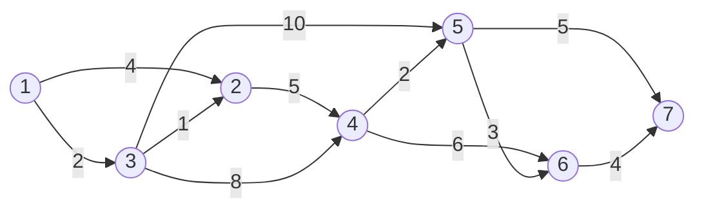
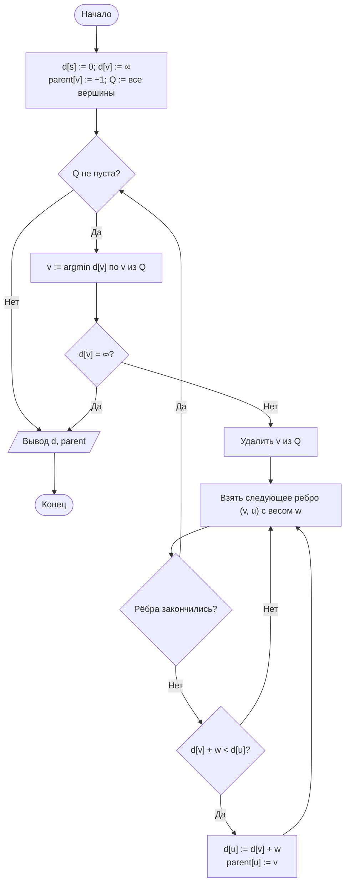
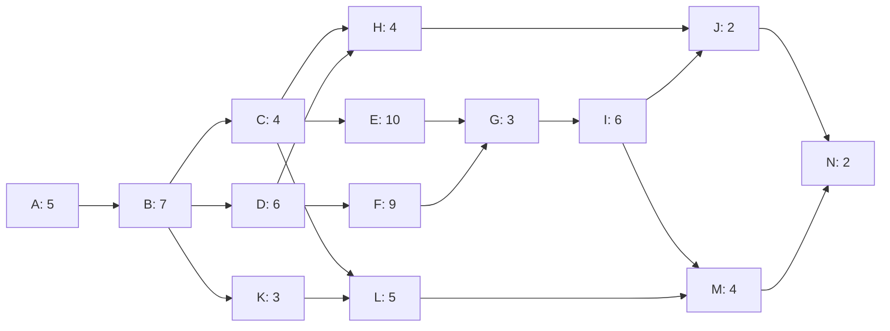
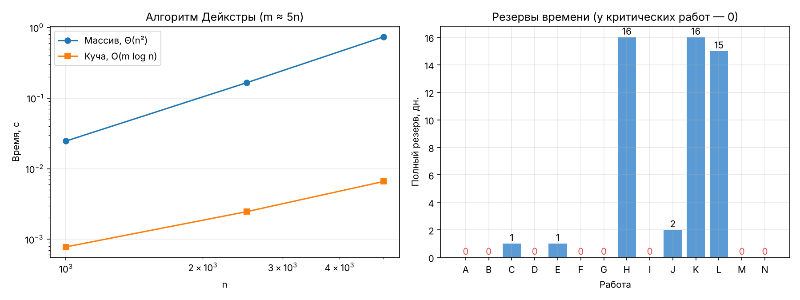
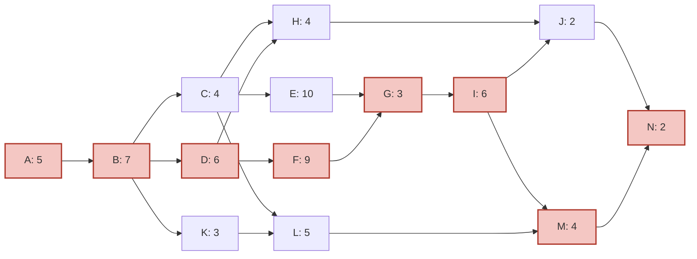

# Отчёт по лабораторной работе № 10

## Алгоритмы поиска кратчайших путей и расчёта критического пути сетевого графика

---

## 1. Титульный лист

| | |
|---|---|
| **Дисциплина** | Теория алгоритмов |
| **Направление подготовки** | 38.03.05 «Бизнес-информатика» |
| **Курс** | 2 |
| **Лабораторная работа** | № 10. Алгоритмы поиска кратчайших путей и расчёта критического пути сетевого графика |
| **Вариант** | 19 |
| **Выполнила** | Ситникова Ольга Алексеевна, группа БИ2-1 |
| **Проверил** | ______________________ |
| **Год** | 2026 |

---

## 2. Цель работы и задание варианта

**Цель работы:** изучить алгоритмы оптимизации на взвешенных графах, реализовать алгоритм Дейкстры в двух вариантах и применить топологическую сортировку к расчёту календарного плана проекта методом критического пути.

**Задание варианта 19:**

| Параметр | Значение |
|---|---|
| Графы для Дейкстры | разреженный, m ≈ 5n (ориентированный, взвешенный) |
| Размеры n | 1000; 2500; 5000 |
| Веса рёбер | целые от 1 до 40 |
| Число работ в проекте | 14 |
| Дополнительное задание | К5 — анализ чувствительности проекта: увеличить длительность каждой работы на 1 день и определить, у каких работ это меняет срок проекта |

**Что выполнено:**

1. Реализован алгоритм Дейкстры с линейным поиском минимума и с приоритетной очередью (`heapq`); корректность проверена на малом графе из 7 вершин с ручным расчётом.
2. Реализовано восстановление кратчайшего пути по массиву предков.
3. Измерено время обеих реализаций на разреженных графах варианта (n = 1000, 2500, 5000; m ≈ 5n; веса 1…40).
4. Реализованы топологическая сортировка (алгоритм Кана) и метод критического пути; рассчитан сетевой график из 14 работ.
5. Выполнено дополнительное задание К5 (анализ чувствительности); дополнительно проверено обнаружение цикла в сетевом графике.

---

## 3. Описание алгоритмов и оценки трудоёмкости

### 3.1. Задача о кратчайших путях

Дан взвешенный ориентированный граф G = (V, E) с весами рёбер w(e) ≥ 0. Длина пути — сумма весов его рёбер. Требуется найти кратчайшие пути из заданной вершины s во все остальные. Основа алгоритмов — свойство оптимальной подструктуры: любой подпуть кратчайшего пути сам является кратчайшим.

### 3.2. Алгоритм Дейкстры

Для каждой вершины v поддерживается оценка d[v] — длина найденного к данному моменту кратчайшего пути из s в v. Вначале d[s] = 0, остальные оценки равны ∞. На каждом шаге:

1. среди ещё не просмотренных вершин выбирается вершина v с наименьшей оценкой d[v]; её оценка объявляется окончательной;
2. выполняется **релаксация** исходящих рёбер: для каждого ребра (v, u) с весом w, если d[v] + w < d[u], то d[u] := d[v] + w и предком u становится v (parent[u] := v).

**Условие применимости:** все веса неотрицательны. Алгоритм считает, что вершина с минимальной оценкой уже не может быть улучшена; при отрицательном ребре это предположение нарушается, и результат может быть неверным. В работе все веса лежат в диапазоне 1…40.

**Две реализации:**

| Реализация | Выбор минимума | Трудоёмкость | Когда выгодна |
|---|---|---|---|
| С линейным поиском (`dijkstra_array`) | просмотр всех n вершин за шаг, Θ(n) | Θ(n²) | плотные графы, m ≈ n² |
| С приоритетной очередью (`dijkstra_heap`) | двоичная куча, O(log n) на операцию | O(m log n) | разреженные графы |

В реализации с кучей вместо удаления/уменьшения ключей используется ленивое удаление: при каждом улучшении оценки в кучу добавляется новая пара (оценка, вершина), а устаревшие записи при извлечении пропускаются.

Для разреженного графа варианта (m ≈ 5n) оценки дают при n = 5000: n² = 25 · 10⁶ операций против m · log₂ n ≈ 3,1 · 10⁵ — различие примерно в 80 раз по числу операций.

**Восстановление пути.** Массив parent[v] хранит предка v на кратчайшем пути. Путь до вершины t восстанавливается движением от t к s по предкам (до значения −1) и разворотом результата; трудоёмкость равна длине пути.

### 3.3. Топологическая сортировка

Ориентированный граф без циклов (DAG) можно упорядочить так, чтобы каждое ребро вело от более ранней вершины к более поздней. Алгоритм Кана:

1. вычислить входящие степени всех вершин;
2. поместить в очередь вершины с нулевой входящей степенью;
3. извлекая вершину, добавить её в результат и уменьшить входящие степени её последователей; при обнулении степени поместить последователя в очередь.

Трудоёмкость Θ(n + m). Если в результат вошли не все вершины, граф содержит цикл: для сетевого графика это означает ошибку исходных данных (работа зависит сама от себя).

### 3.4. Метод критического пути (CPM)

Сетевой график — DAG, вершины которого — работы, а дуги — отношения предшествования; работе i сопоставлена длительность t[i].

**Прямой проход** (в топологическом порядке):

ES[i] = max EF[j] по всем предшественникам j работы i (для работ без предшественников ES = 0), EF[i] = ES[i] + t[i].

Срок проекта T = max EF[i].

**Обратный проход** (в обратном топологическом порядке):

LF[i] = min LS[j] по всем последователям j работы i (для работ без последователей LF = T), LS[i] = LF[i] − t[i].

**Полный резерв времени:** R[i] = LS[i] − ES[i] = LF[i] − EF[i].

**Критический путь** образуют работы с нулевым резервом: задержка любой из них увеличивает срок проекта. Трудоёмкость метода Θ(n + m) — по одному проходу в каждом направлении.

### 3.5. Анализ чувствительности (К5)

Для каждой работы длительность увеличивается на 1 день, срок проекта рассчитывается заново и сравнивается с исходным. Дополнительно находится наименьшее увеличение длительности, при котором срок проекта растёт. По теории это значение равно R[i] + 1: пока работа задерживается не более чем на свой резерв, срок проекта не меняется; у критических работ (R = 0) срок растёт уже при +1 день. Расчёт К5 даёт эмпирическую проверку определения резерва.

---

## 4. Тестовый граф и ручной расчёт кратчайших путей

Тестовый граф: 7 вершин и 11 ориентированных рёбер; источник — вершина 1.



На рисунке синим выделены рёбра дерева кратчайших путей; у вершин указаны найденные расстояния d от вершины 1.

**Ручной расчёт (реализация с линейным поиском минимума).** Вначале d[1] = 0, остальные d = ∞.

| Шаг | Выбранная вершина (d) | Релаксация исходящих рёбер | Обновлённые оценки |
|---|---|---|---|
| 1 | 1 (0) | 1→2: 0 + 4 = 4 < ∞; 1→3: 0 + 2 = 2 < ∞ | d[2] = 4, d[3] = 2 |
| 2 | 3 (2) | 3→2: 2 + 1 = 3 < 4; 3→4: 2 + 8 = 10 < ∞; 3→5: 2 + 10 = 12 < ∞ | d[2] = 3, d[4] = 10, d[5] = 12 |
| 3 | 2 (3) | 2→4: 3 + 5 = 8 < 10 | d[4] = 8 |
| 4 | 4 (8) | 4→5: 8 + 2 = 10 < 12; 4→6: 8 + 6 = 14 < ∞ | d[5] = 10, d[6] = 14 |
| 5 | 5 (10) | 5→6: 10 + 3 = 13 < 14; 5→7: 10 + 5 = 15 < ∞ | d[6] = 13, d[7] = 15 |
| 6 | 6 (13) | 6→7: 13 + 4 = 17 ≥ 15 — улучшения нет | — |
| 7 | 7 (15) | исходящих рёбер нет | — |

Шаг 2 показывает, зачем нужна релаксация: путь 1 → 3 → 2 (длина 3) оказался короче прямого ребра 1 → 2 (длина 4), поэтому оценка d[2] была уточнена.

**Результат расчёта** (совпал с выводом программы для обеих реализаций):

| Вершина | 1 | 2 | 3 | 4 | 5 | 6 | 7 |
|---|---|---|---|---|---|---|---|
| Расстояние d | 0 | 3 | 2 | 8 | 10 | 13 | 15 |
| Кратчайший путь | 1 | 1 → 3 → 2 | 1 → 3 | 1 → 3 → 2 → 4 | 1 → 3 → 2 → 4 → 5 | 1 → 3 → 2 → 4 → 5 → 6 | 1 → 3 → 2 → 4 → 5 → 7 |

Например, путь до вершины 7: 1 → 3 → 2 → 4 → 5 → 7 имеет длину 2 + 1 + 5 + 2 + 5 = 15; путь через вершину 6 (…→ 5 → 6 → 7) длиннее: 13 + 4 = 17.

**Блок-схема алгоритма Дейкстры:**



---

## 5. Сетевой график проекта

Проект «Внедрение информационной системы» состоит из 14 работ; в графике есть параллельные ветви (проектирование базы данных и интерфейса, разработка серверной и клиентской частей, подготовка документации, настройка инфраструктуры и миграция данных). Работы A–J взяты из базового набора, работы K–N добавлены для достижения 14 работ с сохранением ацикличности.

**Таблица 1. Работы проекта**

| Код | Наименование работы | Длительность, дн. | Предшественники |
|---|---|---|---|
| A | Сбор требований | 5 | — |
| B | Анализ бизнес-процессов | 7 | A |
| C | Проектирование базы данных | 4 | B |
| D | Проектирование интерфейса | 6 | B |
| E | Разработка серверной части | 10 | C |
| F | Разработка клиентской части | 9 | D |
| G | Интеграция модулей | 3 | E, F |
| H | Подготовка документации | 4 | C, D |
| I | Тестирование | 6 | G |
| J | Обучение пользователей | 2 | H, I |
| K | Настройка серверной инфраструктуры | 3 | B |
| L | Миграция данных | 5 | C, K |
| M | Приёмочные испытания | 4 | I, L |
| N | Запуск в эксплуатацию | 2 | J, M |

**Сетевой график** (в вершинах: код работы и длительность в днях; критические работы выделены на рисунке при расчёте в разделе 8):



---

## 6. Листинг программы

Файл `lab10_variant19.py` (Python 3.10+, для графиков нужна библиотека `matplotlib`). Каждая строка снабжена комментарием.

```python
"""Лабораторная работа № 10. Вариант 19. Ситникова Ольга Алексеевна."""
import heapq  # приоритетная очередь (двоичная куча)
import platform  # сведения о компьютере
import random  # случайные графы
import time  # замер времени
from collections import deque  # очередь для алгоритма Кана
import matplotlib.pyplot as plt  # графики

INF = float("inf")  # «бесконечность» для начальных оценок расстояний
SIZES = [1000, 2500, 5000]  # размеры графа n по варианту 19 (разреженный, m ≈ 5n, веса 1…40)


def dijkstra_array(adj, s):  # Дейкстра с линейным поиском минимума, Θ(n²)
    n = len(adj)  # число вершин
    dist, parent, used = [INF] * n, [-1] * n, [False] * n  # расстояния, предки и отметки «просмотрена»
    dist[s] = 0  # расстояние до источника
    for _ in range(n):  # n шагов
        v, best = -1, INF  # вершина с минимальной оценкой
        for i in range(n):  # линейный поиск минимума среди непросмотренных
            if not used[i] and dist[i] < best:  # нашли оценку меньше текущей
                v, best = i, dist[i]  # запоминаем вершину и оценку
        if v == -1:  # достижимые вершины закончились
            break  # выходим
        used[v] = True  # вершина просмотрена: её оценка окончательна
        for u, w in adj[v]:  # релаксация исходящих рёбер
            if dist[v] + w < dist[u]:  # путь через v короче
                dist[u], parent[u] = dist[v] + w, v  # обновляем оценку и предка
    return dist, parent  # расстояния и предки


def dijkstra_heap(adj, s):  # Дейкстра с приоритетной очередью, O(m log n)
    n = len(adj)  # число вершин
    dist, parent = [INF] * n, [-1] * n  # расстояния и предки
    dist[s] = 0  # расстояние до источника
    heap = [(0, s)]  # куча пар (оценка, вершина)
    while heap:  # пока куча не пуста
        d, v = heapq.heappop(heap)  # вершина с наименьшей оценкой
        if d > dist[v]:  # запись устарела
            continue  # пропускаем
        for u, w in adj[v]:  # релаксация исходящих рёбер
            if d + w < dist[u]:  # путь через v короче
                dist[u], parent[u] = d + w, v  # обновляем оценку и предка
                heapq.heappush(heap, (dist[u], u))  # кладём новую оценку в кучу
    return dist, parent  # расстояния и предки


def restore_path(parent, target):  # восстановление пути по массиву предков
    path = []  # вершины пути в обратном порядке
    while target != -1:  # идём от цели к источнику
        path.append(target)  # добавляем вершину
        target = parent[target]  # переходим к предку
    return path[::-1]  # путь от источника к цели


def generate_graph(n, m, max_weight=40, seed=42):  # случайный ориентированный граф: n вершин, около m рёбер
    rng = random.Random(seed)  # генератор с фиксированным seed
    adj = [[] for _ in range(n)]  # списки смежности с весами
    for i in range(1, n):  # остовное дерево гарантирует достижимость всех вершин из 0
        adj[rng.randrange(i)].append((i, rng.randint(1, max_weight)))  # ребро от случайной предыдущей вершины
    for _ in range(m - (n - 1)):  # остальные рёбра случайны
        u, v = rng.randrange(n), rng.randrange(n)  # случайная пара вершин
        if u != v:  # петли не допускаются
            adj[u].append((v, rng.randint(1, max_weight)))  # ребро со случайным весом
    return adj  # граф


def topological_order(tasks):  # топологическая сортировка (алгоритм Кана); tasks: код -> (длительность, предшественники)
    indeg = {k: len(v[1]) for k, v in tasks.items()}  # входящие степени
    succ = {k: [] for k in tasks}  # последователи каждой работы
    for k, (_, preds) in tasks.items():  # строим списки последователей
        for p in preds:  # для каждого предшественника
            succ[p].append(k)  # k следует за p
    queue = deque(sorted(k for k, d in indeg.items() if d == 0))  # работы без предшественников
    order = []  # топологический порядок
    while queue:  # пока очередь не пуста
        v = queue.popleft()  # берём работу
        order.append(v)  # добавляем в порядок
        for u in succ[v]:  # уменьшаем степени последователей
            indeg[u] -= 1  # одним предшественником меньше
            if indeg[u] == 0:  # все предшественники выполнены
                queue.append(u)  # работа готова к началу
    if len(order) != len(tasks):  # в порядок вошли не все работы
        raise ValueError("Сетевой график содержит цикл")  # цикл — ошибка исходных данных
    return order, succ  # порядок и последователи


def critical_path(tasks):  # метод критического пути: сроки, резервы, критические работы
    order, succ = topological_order(tasks)  # порядок работ
    ES, EF = {}, {}  # ранний старт и раннее окончание
    for v in order:  # прямой проход
        ES[v] = max((EF[p] for p in tasks[v][1]), default=0)  # старт после всех предшественников
        EF[v] = ES[v] + tasks[v][0]  # окончание = старт + длительность
    T = max(EF.values())  # длительность проекта
    LS, LF = {}, {}  # поздний старт и позднее окончание
    for v in reversed(order):  # обратный проход
        LF[v] = min((LS[u] for u in succ[v]), default=T)  # окончание не позже старта последователей
        LS[v] = LF[v] - tasks[v][0]  # поздний старт
    R = {v: LS[v] - ES[v] for v in tasks}  # полный резерв времени
    return T, ES, EF, LS, LF, R, [v for v in order if R[v] == 0]  # критические работы имеют нулевой резерв


def sensitivity(tasks):  # К5: изменение срока при +1 день и наименьшее увеличение, меняющее срок проекта
    T0, res = critical_path(tasks)[0], {}  # исходный срок и результат
    for v, (t, preds) in tasks.items():  # перебираем работы
        delta = 1  # пробное увеличение длительности
        while critical_path({**tasks, v: (t + delta, preds)})[0] == T0:  # срок не изменился
            delta += 1  # увеличиваем ещё на день
        res[v] = (critical_path({**tasks, v: (t + 1, preds)})[0] - T0, delta)  # (рост срока при +1 день, порог)
    return res  # результаты по работам


def best_time(func, repeats):  # лучшее время func из нескольких повторов, с
    times = []  # времена повторов
    for _ in range(repeats):  # повторы
        t0 = time.perf_counter()  # начало замера
        func()  # запуск
        times.append(time.perf_counter() - t0)  # длительность
    return min(times)  # наименее искажённое помехами значение


if __name__ == "__main__":  # запуск только при прямом старте файла
    print(platform.platform(), "|", platform.processor() or platform.machine(), "| Python", platform.python_version())  # система
    small = [[(1, 4), (2, 2)], [(3, 5)], [(1, 1), (3, 8), (4, 10)], [(4, 2), (5, 6)], [(5, 3), (6, 5)], [(6, 4)], []]  # тестовый граф: 7 вершин (1…7), 11 рёбер
    d1, p1 = dijkstra_array(small, 0)  # реализация с массивом
    d2, p2 = dijkstra_heap(small, 0)  # реализация с кучей
    assert d1 == d2 and p1 == p2  # обе реализации совпадают
    print("\nТестовый граф, расстояния от вершины 1 и кратчайшие пути:")  # заголовок
    for v in range(7):  # по всем вершинам
        print(f"  до {v + 1}: {d1[v]:>2}, путь {' -> '.join(str(x + 1) for x in restore_path(p1, v))}")  # результат
    print("\n     n       m | массив, с |   куча, с | отношение")  # заголовок таблицы
    rows = []  # результаты замеров
    for n in SIZES:  # перебираем размеры
        adj = generate_graph(n, 5 * n)  # разреженный граф m ≈ 5n
        m = sum(len(a) for a in adj)  # фактическое число рёбер
        assert dijkstra_array(adj, 0)[0] == dijkstra_heap(adj, 0)[0]  # реализации дают одинаковые расстояния
        t_arr = best_time(lambda: dijkstra_array(adj, 0), 3 if n <= 2500 else 2)  # время реализации с массивом
        t_heap = best_time(lambda: dijkstra_heap(adj, 0), 15)  # время реализации с кучей
        rows.append((n, m, t_arr, t_heap))  # сохраняем строку
        print(f"{n:>6} {m:>7} | {t_arr:>9.4f} | {t_heap:>9.4f} | {t_arr / t_heap:>9.1f}")  # строка таблицы
    adj = generate_graph(1000, 5000)  # граф для примера восстановления пути
    dist, parent = dijkstra_heap(adj, 0)  # расстояния от вершины 0
    far = max(range(1000), key=lambda v: dist[v] if dist[v] < INF else -1)  # самая удалённая вершина
    print(f"\nn = 1000: самая удалённая вершина {far}, расстояние {dist[far]}, путь: {' -> '.join(map(str, restore_path(parent, far)))}")  # путь
    tasks = {  # сетевой график проекта из 14 работ: код -> (длительность, предшественники)
        "A": (5, []), "B": (7, ["A"]), "C": (4, ["B"]), "D": (6, ["B"]), "E": (10, ["C"]), "F": (9, ["D"]),  # работы A–F
        "G": (3, ["E", "F"]), "H": (4, ["C", "D"]), "I": (6, ["G"]), "J": (2, ["H", "I"]),  # работы G–J
        "K": (3, ["B"]), "L": (5, ["C", "K"]), "M": (4, ["I", "L"]), "N": (2, ["J", "M"]),  # работы K–N
    }
    T, ES, EF, LS, LF, R, crit = critical_path(tasks)  # расчёт критического пути
    sens = sensitivity(tasks)  # анализ чувствительности (К5)
    print(f"\nДлительность проекта: {T} дн.")  # срок проекта
    print("Работа  t  ES  EF  LS  LF  Резерв  Крит.  +1 день -> срок  Порог роста срока")  # заголовок таблицы
    for v in sorted(tasks):  # по работам
        print(f"{v:>6} {tasks[v][0]:>2} {ES[v]:>3} {EF[v]:>3} {LS[v]:>3} {LF[v]:>3} {R[v]:>7} {'да' if R[v] == 0 else '':>6} {'+' + str(sens[v][0]):>9}      {sens[v][1]:>10}")  # строка
    print("Критический путь:", " -> ".join(crit))  # критические работы
    cyc = {**tasks, "A": (5, ["N"])}  # график с искусственным циклом
    try:  # проверка обнаружения цикла
        critical_path(cyc)  # расчёт должен завершиться ошибкой
    except ValueError as e:  # ожидаемая ошибка
        print("Проверка цикла:", e)  # сообщение об ошибке
    fig, (ax1, ax2) = plt.subplots(1, 2, figsize=(12, 4.5))  # два графика рядом
    ns = [r[0] for r in rows]  # размеры n
    ax1.plot(ns, [r[2] for r in rows], "o-", label="Массив, Θ(n²)")  # время реализации с массивом
    ax1.plot(ns, [r[3] for r in rows], "s-", label="Куча, O(m log n)")  # время реализации с кучей
    ax1.set(xlabel="n", ylabel="Время, с", title="Алгоритм Дейкстры (m ≈ 5n)", xscale="log", yscale="log")  # оформление
    ax1.legend()  # легенда
    codes = sorted(tasks)  # коды работ
    ax2.bar(codes, [R[v] for v in codes], color=["#d9534f" if R[v] == 0 else "#5b9bd5" for v in codes])  # резервы: критические красным
    for i, v in enumerate(codes):  # подписываем значение резерва над каждым столбцом
        ax2.text(i, R[v] + 0.2, str(R[v]), ha="center", color="#d9534f" if R[v] == 0 else "black")  # у критических работ — «0»
    ax2.set(xlabel="Работа", ylabel="Полный резерв, дн.", title="Резервы времени (у критических работ — 0)")  # оформление
    for ax in (ax1, ax2):  # общее оформление
        ax.grid(True, alpha=0.3)  # сетка
    plt.tight_layout()  # убираем наложение подписей
    plt.savefig("lab10_graphs.png", dpi=150)  # сохраняем график для отчёта
    plt.show()  # показываем график на экране
```

---

## 7. Таблицы измерений и графики для двух реализаций Дейкстры

**Условия измерений:** Linux (Ubuntu 24.04), Intel Xeon @ 2,10 ГГц (1 виртуальное ядро), 3 ГБ ОЗУ, Python 3.12.3, matplotlib 3.11. Графы — случайные ориентированные взвешенные (`seed = 42`): n − 1 рёбер остовного дерева (для достижимости всех вершин из вершины 0) и остальные рёбра случайны, веса — целые от 1 до 40; фактическое число рёбер m немного меньше 5n, так как петли отбрасываются. Источник — вершина 0. Время — лучшее из нескольких повторов (`time.perf_counter()`). Обе реализации дали одинаковые расстояния на всех графах (проверка `assert`).

**Таблица 2. Время работы двух реализаций алгоритма Дейкстры**

| n | m | Массив, с | Куча, с | Отношение (массив / куча) |
|---|---|---|---|---|
| 1000 | 4994 | 0,0247 | 0,0008 | 31,7 |
| 2500 | 12 494 | 0,1657 | 0,0025 | 67,3 |
| 5000 | 24 994 | 0,7401 | 0,0066 | 112,4 |

**Таблица 3. Сопоставление с теоретическими оценками**

| n | n² (массив) | m · log₂ n (куча) | Отношение оценок | Измеренное отношение |
|---|---|---|---|---|
| 1000 | 1 000 000 | 49 769 | 20,1 | 31,7 |
| 2500 | 6 250 000 | 141 029 | 44,3 | 67,3 |
| 5000 | 25 000 000 | 307 119 | 81,4 | 112,4 |

Измеренное отношение выше отношения оценок во всех строках: цикл поиска минимума в реализации с массивом выполняется на интерпретируемом Python (n² шагов), а основные операции кучи (`heappush`, `heappop`) реализованы на языке C, поэтому константы у двух реализаций различаются в пользу кучи. Характер роста при этом совпадает с теорией (таблица 4).

**Таблица 4. Рост времени при увеличении n**

| Переход | Массив, измерено | Теория Θ(n²) | Куча, измерено | Теория O(m log n) |
|---|---|---|---|---|
| 1000 → 2500 (n в 2,5 раза) | 6,7 | 6,25 | 3,1 | 2,8 |
| 2500 → 5000 (n в 2 раза) | 4,5 | 4,0 | 2,6 | 2,2 |

Времена реализации с кучей очень малы (единицы миллисекунд), поэтому их отношения определены с точностью порядка 10–20 %.

**Пример восстановления пути.** В графе из 1000 вершин самой удалённой от источника оказалась вершина 857, расстояние до неё равно 104; путь содержит 12 рёбер: 0 → 1 → 99 → 606 → 86 → 750 → 961 → 367 → 923 → 9 → 52 → 358 → 857.

**Графики** (слева — время двух реализаций Дейкстры, обе оси логарифмические; справа — резервы времени работ, см. раздел 8):



---

## 8. Расчёт сроков работ и критический путь

Расчёт выполнен программой по формулам раздела 3.4; топологический порядок получен алгоритмом Кана.

**Таблица 5. Расчёт сетевого графика проекта**

| Работа | t | ES | EF | LS | LF | Резерв R | Критическая |
|---|---|---|---|---|---|---|---|
| A | 5 | 0 | 5 | 0 | 5 | 0 | да |
| B | 7 | 5 | 12 | 5 | 12 | 0 | да |
| C | 4 | 12 | 16 | 13 | 17 | 1 | |
| D | 6 | 12 | 18 | 12 | 18 | 0 | да |
| E | 10 | 16 | 26 | 17 | 27 | 1 | |
| F | 9 | 18 | 27 | 18 | 27 | 0 | да |
| G | 3 | 27 | 30 | 27 | 30 | 0 | да |
| H | 4 | 18 | 22 | 34 | 38 | 16 | |
| I | 6 | 30 | 36 | 30 | 36 | 0 | да |
| J | 2 | 36 | 38 | 38 | 40 | 2 | |
| K | 3 | 12 | 15 | 28 | 31 | 16 | |
| L | 5 | 16 | 21 | 31 | 36 | 15 | |
| M | 4 | 36 | 40 | 36 | 40 | 0 | да |
| N | 2 | 40 | 42 | 40 | 42 | 0 | да |

**Длительность проекта: 42 дня. Критический путь: A → B → D → F → G → I → M → N.**

Проверка: 5 + 7 + 6 + 9 + 3 + 6 + 4 + 2 = 42.

Пример ручного расчёта для работы L (миграция данных): предшественники C (EF = 16) и K (EF = 15), поэтому ES[L] = max(16, 15) = 16, EF[L] = 16 + 5 = 21; единственный последователь M имеет LS = 36, поэтому LF[L] = 36, LS[L] = 36 − 5 = 31, резерв R[L] = 31 − 16 = 15.

**Сетевой график с выделенным критическим путём** (критические работы и дуги — красные):



### 8.1. Анализ чувствительности (К5)

Длительность каждой работы увеличена на 1 день, и срок проекта пересчитан; кроме того, найдено наименьшее увеличение длительности, при котором срок проекта растёт.

**Таблица 6. Результаты анализа чувствительности**

| Работа | Резерв R | Срок проекта при +1 день | Изменение срока | Наименьшее увеличение, меняющее срок проекта |
|---|---|---|---|---|
| A, B, D, F, G, I, M, N (критические) | 0 | 43 | +1 | 1 |
| C | 1 | 42 | 0 | 2 |
| E | 1 | 42 | 0 | 2 |
| J | 2 | 42 | 0 | 3 |
| L | 15 | 42 | 0 | 16 |
| H | 16 | 42 | 0 | 17 |
| K | 16 | 42 | 0 | 17 |

**Выводы по К5.**

- Увеличение на 1 день меняет срок проекта **только у 8 критических работ** (A, B, D, F, G, I, M, N): срок растёт ровно на 1 день, до 43.
- У всех шести некритических работ (C, E, H, J, K, L) срок не изменился: задержка в 1 день укладывается в резерв.
- Наименьшее увеличение, меняющее срок, у каждой работы равно R + 1 (1 у критических, 2 у C и E, 3 у J, 16 у L, 17 у H и K): расчёт подтвердил определение резерва — пока работа задерживается не более чем на R дней, срок проекта не меняется, а ещё на день позже он растёт.
- Работы C и E (резерв 1 день) образуют **почти критическую ветвь** C → E → G: её длительность на день меньше критической ветви D → F → G. Она станет критической при любой задержке более чем на день, поэтому за ней нужен тот же контроль, что и за критическим путём.
- У работ H, K и L резерв 15–16 дней: на них можно перераспределять ресурсы без риска для срока проекта.

**Проверка обнаружения цикла.** При искусственном добавлении зависимости «A после N» алгоритм Кана не включает в порядок все работы, и программа сообщает: «Сетевой график содержит цикл».

---

## 9. Выводы

1. Реализация алгоритма Дейкстры с приоритетной очередью на разреженных графах (m ≈ 5n) значительно быстрее реализации с линейным поиском: в 32, 67 и 112 раз при n = 1000, 2500, 5000, и разрыв растёт с n. Это соответствует оценкам O(m log n) и Θ(n²): измеренный рост времени при увеличении n в 2 раза (4,5 раза у массива и 2,6 раза у кучи) близок к теоретическим 4 и 2,2.
2. Обе реализации дают одинаковые расстояния (проверено на всех тестовых графах), а ручной расчёт на графе из 7 вершин совпал с выводом программы. Путь восстанавливается по массиву предков за время, равное его длине.
3. Для графов с большим числом вершин и умеренным числом рёбер следует применять Дейкстру на куче; реализацию с массивом оправдано использовать на плотных графах (m ≈ n²), где куча теряет преимущество. Алгоритм применим только при неотрицательных весах.
4. Топологическая сортировка и метод критического пути работают за Θ(n + m): расчёт проекта из 14 работ выполняется за два прохода. Срок проекта — 42 дня, критический путь A → B → D → F → G → I → M → N; на нём лежит 8 из 14 работ, остальные имеют резерв от 1 до 16 дней.
5. Анализ чувствительности (К5) показал, что срок проекта увеличивается при задержке на 1 день только у критических работ. Для остальных наименьшее изменение срока определяется резервом: оно равно R + 1. Практически это означает, что контроль нужно сосредоточить на критических работах и на работах с малым резервом (C, E, J), а работы с большим резервом (H, K, L) можно сдвигать для выравнивания загрузки ресурсов.
6. Алгоритм Кана одновременно служит проверкой корректности исходных данных: при наличии цикла в зависимостях расчёт останавливается с сообщением об ошибке.
